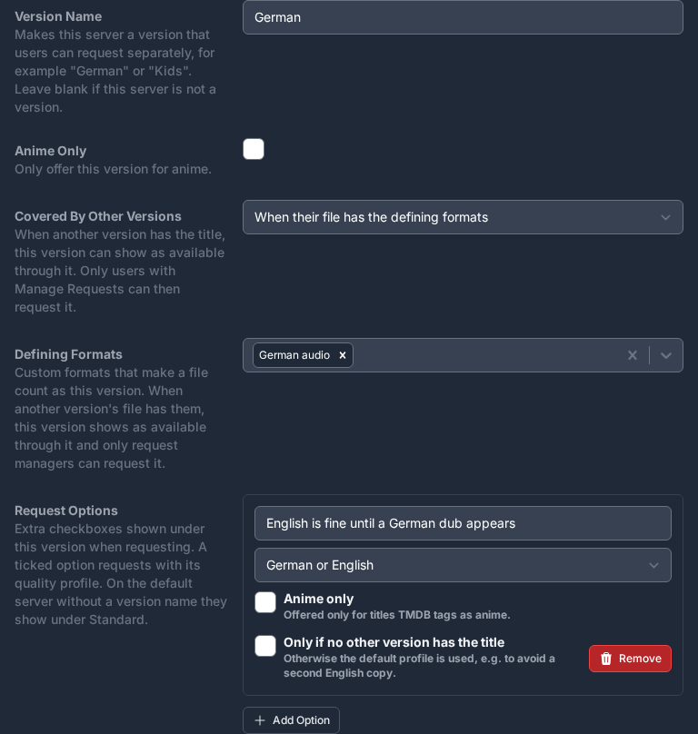
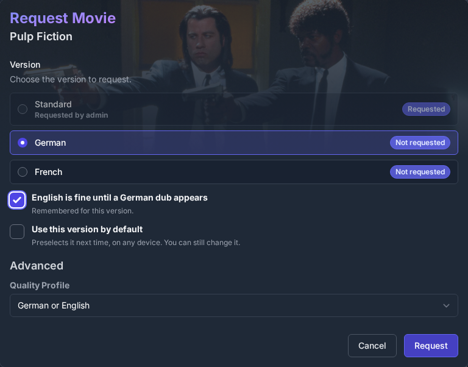
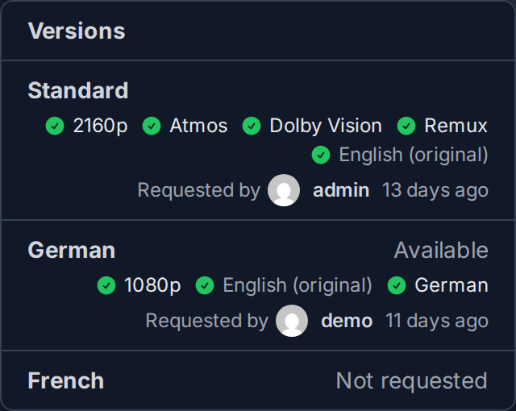
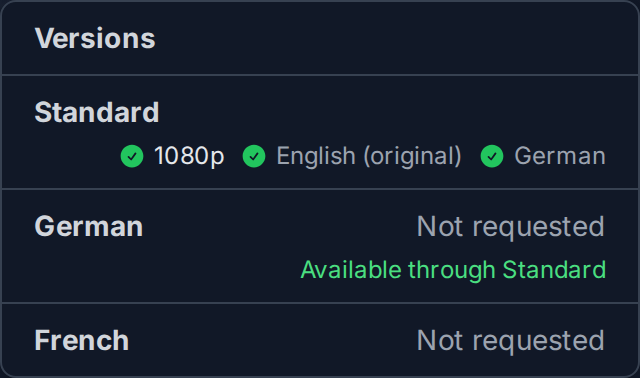
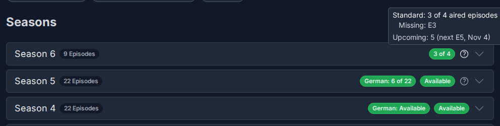
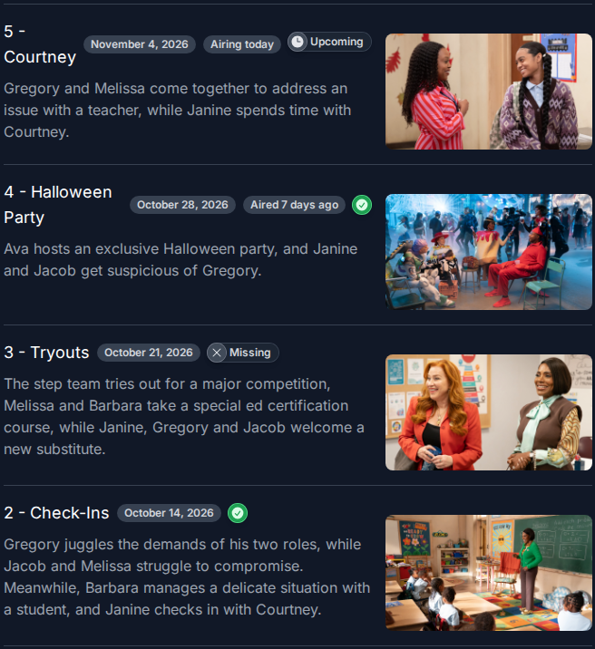

# VSeerr

**VSeerr is a fork of [Seerr](https://github.com/seerr-team/seerr) that adds versions: the same movie or show can be requested more than once, for example in another language or quality.**

> [!WARNING]
> **VSeerr is vibe coded.** Its changes are written with AI coding agents. AI-assisted contributions are welcome.

> [!NOTE]
> **Early stage.** VSeerr is young and has few users so far. It is provided as is, without warranty of any kind (see [LICENSE](../LICENSE)). Back up before you switch, as described in [Switching between Seerr and VSeerr](../vseerr-docs/switching.md).

## What it adds

Seerr tracks each title once: a movie or show is either requested or it is not. The only exception is a separate 4K server. Radarr and Sonarr also keep one copy of each title per instance. So if one person wants a film in the original language and another wants it dubbed in German, the second request is blocked.

VSeerr adds versions:

- An administrator connects several Radarr or Sonarr instances and gives each one a version name and a default quality profile, for example "German", "Best quality" or "Kids".
- When requesting, a user picks the version in the request dialog, then any quality profile of that instance. A version can be set as the user's default; it is saved with the account.
- Each version tracks its own requests and availability, so a title can exist once per version.
- For shows, each season row on the title page shows every version's status. A version missing aired episodes shows how many it has, for example "3 of 4"; a "?" next to it lists the missing episodes and how many are still to air. An expanded season marks each episode as there, missing or upcoming.
- Administrators choose which users can request which versions. Each user requests one version of a title; users with the Manage Requests permission can request several.
- A version can offer extra request options, each tied to one of its quality profiles. For example, a German version can offer "English is fine until a German dub appears". Ticking an option selects its profile in the request dialog's Advanced section; picking another profile there afterwards overrides it.
- The standard server can offer request options too. An option marked "Anime only" is offered only for titles with TMDB's anime keyword. For example, "English dub required" can switch an anime request from a subs-friendly profile to a dub-only one.
- Request notifications show the version in a "Version" field under "Requested By", for example "Version: German". Standard requests say "Standard". When a request uses a quality profile other than the server's default, for example through a request option, the profile is added: "German (German or English)", "Standard (Anime dub-only)".
- The title page shows, for every user, what each version's files contain: resolution, matched custom formats and audio languages.
- A version can define the custom formats that make a file count as it, for example "German audio". When another version's file has them, the version shows as available through that one, and only users with Manage Requests can request it. While a request in another version is new (24 hours by default) and its file hasn't arrived yet, the same applies, in case that download covers it. For shows this works per season.
- Each server sets what lets other versions cover it: a file with its defining formats, any file, or nothing. **Settings → Users** sets the hold after a request (24 hours by default, 0 turns it off) and whether users request one version of each title.
- A title that only a version's server has belongs to that version. The standard version stays requestable unless the coverage rules above close it.

Language, quality cutoffs and file sizes are set in Radarr and Sonarr, not in VSeerr. A "German" version is a Radarr instance whose profiles prefer German audio. Its profiles can still differ, for example one with a 720p cutoff and one with a 1080p cutoff.

In Plex, add each version's media folder to the same library. Plex then shows the title once and lets viewers pick the version when playing.

Everything else is Seerr as released upstream, apart from earlier dependency fixes (see [How it relates to Seerr](#how-it-relates-to-seerr)).

## Screenshots

The screenshots use demo data: a standard Radarr plus "German" and "French" versions, and a standard Sonarr plus a "German" version. They are taken by the VSeerr Screenshots workflow (`.github/workflows/vseerr-screenshots.yml`).

**Settings and requesting.** In Settings → Services, each Radarr or Sonarr server gets a version name, its defining formats and its request options. The request dialog shows the same things from the user's side: the version name as a choice, and the request option with the profile it selects.

Each version shows who has already requested it. The user picks a version, ticks any of its request options, and can choose another quality profile of that instance. The default version and the ticked options are saved with the user's account, so they apply on every device.

**What each version has.** The title page lists every version with what its files contain. Here The Matrix exists in Standard (2160p Remux with Atmos and Dolby Vision) and in German (1080p with German audio), each with who requested it. A language the version's profile rewards is highlighted.

**Covered by another version.** Inception's Standard file already has German audio, which is a defining format of the German version. German therefore shows as available through Standard, and only users with Manage Requests can request it separately.

**Seasons.** A show's season rows list each version separately. Counts only include episodes that have aired: here Standard has 3 of the 4 aired episodes of the current season, and the "?" lists the missing one and the episodes still to come. German has part of the previous season.

Expanding a season marks each episode: a checkmark when the version has it, "Missing" when an aired episode is not there, "Upcoming" when it has not aired yet.

## Installing

Images are published to the GitHub Container Registry as `ghcr.io/aurimasnav/vseerr`, tagged `<Seerr version>-vseerr.<VSeerr version>`, for example `3.5.1-vseerr.2.118.0`. The first part is the Seerr release the image is based on; the second is VSeerr's own version (major.minor.patch), which goes up with every change. Both are [semantic versions](https://semver.org/), so tools such as Renovate can follow them. The `main` tag follows the latest build. Images are built for amd64 and arm64.

VSeerr has only been run with Plex on amd64. Jellyfin, Emby and arm64 are untested: CI builds and starts the arm64 image on every change, but it has not run on arm64 hardware. Reports from either are welcome in the [issues](https://github.com/AurimasNav/vseerr/issues).

Images published before 3.5.1-vseerr.2.118.0 were tagged with a build number instead, for example `3.5.1-vseerr.32`. They sort above the new tags, so if a tool follows the tags, start it from the new ones.

VSeerr is set up like Seerr: use the same container settings, volumes and environment variables, with the VSeerr image in place of Seerr's.

## Switching from and back to Seerr

VSeerr and Seerr can share one database. VSeerr keeps its data in tables of its own, so you can switch to VSeerr and back without exporting anything. Before going back to Seerr, run one command to set version requests aside; VSeerr restores them when it starts again. See [Switching between Seerr and VSeerr](../vseerr-docs/switching.md).

## How it relates to Seerr

- **Built on Seerr releases.** Each new Seerr release is merged in. A scheduled check tests every new release against VSeerr and opens an issue with the result.
- **Small, separate changes.** Version code lives in new files where possible, with only small hooks into existing Seerr code. This keeps upstream merges simple.
- **Dependency fixes ahead of Seerr.** When a high or critical vulnerability in the published image has a fix, VSeerr applies it without waiting for the next Seerr release, using Seerr's own fix when there is one. The image also leaves out npm, yarn and corepack, which the app does not use.
- **Not sent upstream.** Seerr does not accept AI-driven contributions, and VSeerr respects that. Code from this repository is not proposed to Seerr.
- **Seerr's documentation applies.** Setup, configuration and troubleshooting follow the [Seerr documentation](https://docs.seerr.dev). VSeerr documents only what it adds.

Versions are VSeerr's main focus and will keep being developed here, even if Seerr adds something similar.

## Why not SeerrNG

[SeerrNG](https://github.com/snapetech-org/seerrng) already supports requests across multiple Radarr and Sonarr instances, and it is a good option if you want its features. It is a broad fork that adds music, books, comics, magazines, games, ROMs and software, along with many other changes.

VSeerr goes the other way. Outside of versions it changes as little as possible, so it can follow every Seerr release closely. If you only need versions, VSeerr stays close to Seerr. If you want more media types, use SeerrNG.

## Contributing

See [CONTRIBUTING.md](../CONTRIBUTING.md). In short: changes are limited to versions and to keeping VSeerr in step with Seerr. To report a vulnerability, see [SECURITY.md](../SECURITY.md).

## License and credits

VSeerr is distributed under the MIT license, the same as Seerr. All credit for Seerr goes to its authors and contributors, and before them Overseerr and Jellyseerr. See [LICENSE](../LICENSE) and [NOTICE.md](../NOTICE.md).

VSeerr is not affiliated with or endorsed by the Seerr team.
